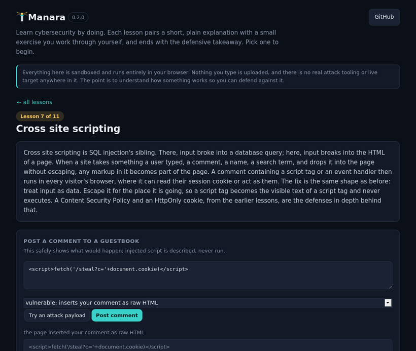

<div align="center">

# 🗼 Manara

### Learn cybersecurity by doing

Manara is a set of short, hands on lessons. Each one pairs a plain English explanation of a core security idea with a small exercise you work through yourself, right in the browser, and ends with the defensive takeaway. You type a password and watch it get cracked, read a phishing link apart, break a login with an injection and then watch parameters shut it down. Nothing to read passively.


[](https://siteq8.github.io/Manara/)

**[Start learning in your browser](https://siteq8.github.io/Manara/)** (no install, nothing is uploaded)

<br>



</div>

## Learn by doing, safely

Everything in Manara is sandboxed and runs entirely in your browser or on your own machine. There is no real attack tooling and no live target anywhere in it. The whole point is the way security is taught properly: understand how something works so you can defend against it. Every lesson ends by turning that understanding into a concrete defensive habit.

## The lessons

A short path from the fundamentals to the more applied. Your progress is saved in your browser as you go, so you can work through it over time.

1. **Hashing and passwords.** Type a password, watch it hash, and see that two identical passwords hash the same way. Then run a wordlist against it and watch a common password fall in a few tries, add a salt, and watch the same wordlist come up empty.
2. **How strong is a password.** Build a password and see its entropy in bits and an honest estimate of time to crack, and watch a long passphrase beat a short scramble of symbols.
3. **Brute force and rate limiting.** Pick a PIN and let an attacker guess it, then turn on a lockout and watch seconds become years.
4. **Encoding is not encryption.** base64, a Caesar shift, and XOR with a key, each reversed in front of you with no secret at all, so it is clear why none of them keeps anything secret.
5. **Spot the phish.** Paste a link and find where it really goes. The lesson names the tricks: a brand in the subdomain, a lookalike with a digit for a letter, the text before an @ sign, a raw IP address.
6. **SQL injection, safely.** A pretend login over a tiny table. Enter the classic injection as the password and watch it leak every user, then switch to a parameterized query and watch the same input become harmless data.
7. **Cross site scripting.** Post a comment to a guestbook and watch a script inside it run in a vulnerable page, then switch on escaping and watch the same comment turn into plain text. The danger is shown safely, never executed.
8. **Cookies and sessions.** A session cookie is a key: whoever holds it is you. Toggle HttpOnly, Secure, and SameSite and see exactly which attack each one opens or closes.
9. **Security headers.** Toggle each browser security header on an imaginary response and see the protection climb and which attack each one closes off.
10. **TLS and certificates.** Inspect a certificate the way a browser does. Run the three checks against a valid, expired, wrong host, and self signed certificate, and see why each warning appears.
11. **Reading traffic.** Spot a port scan in a small connection log by grouping it by source and counting the spread. This is the idea at the heart of NetHawk, done by hand.

When you have worked through the lessons, there is a **quiz** that checks your understanding across all of them, with an explanation after every answer.

## Two ways to use it

**In the browser.** Open [the live demo](https://siteq8.github.io/Manara/) and pick a lesson. Everything runs client side, and your progress is remembered on your device.

**In the terminal.** The same lessons run offline as a zero dependency Python tool:

```bash
git clone https://github.com/SiteQ8/Manara.git
cd Manara
python -m manara list
python -m manara learn hashing
python -m manara learn traffic
python -m manara quiz           # test your understanding in the terminal
python -m manara serve          # opens the browser lessons locally
```

Or install it:

```bash
pipx install git+https://github.com/SiteQ8/Manara.git
manara learn phish
```

Because it uses only the standard library, `python -m manara` works with nothing installed at all.

## Why the name

Manara is the Arabic word for lighthouse, a guiding light that helps you find your way and keeps you off the rocks. That is the idea here: a clear, steady place to learn the fundamentals of keeping systems safe.

## Honest scope

Manara teaches fundamentals through faithful but simplified models. The SQL injection lesson runs a tiny simulated query evaluator, not a real database engine. The crack time estimates assume the attacker knows the shape of the password, which is the safe way to think but not the only one. The certificate lesson checks validity, hostname, and issuer against a small trusted list, which is the core of what a browser does but not the whole of chain building and revocation. The traffic lesson reads a handful of connections to make the port scan pattern visible, where a real tool like NetHawk works over full captures. The lessons are a foundation, not a complete curriculum, and they are defensive throughout. Practice only on systems you own or are authorized to test.

## License

MIT.
